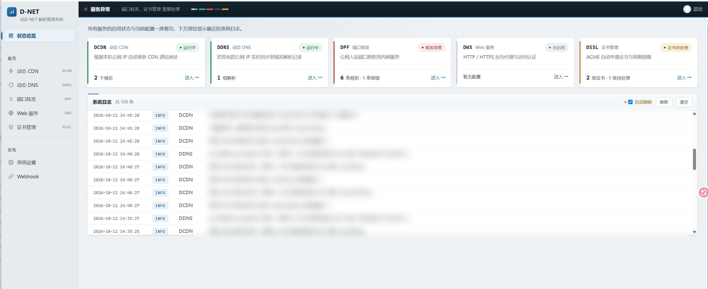

<div align="center">

# D-NET 动态网络管理系统

**轻量级自托管网络管理工具** —— 一套面板搞定 DDNS、动态 CDN、端口转发、反向代理、在线测速与自动证书，支持 20+ 云厂商。

[](https://github.com/KingNuoNuo/dnet/stargazers)
[](https://github.com/KingNuoNuo/dnet/network/members)
[](https://github.com/KingNuoNuo/dnet/watchers)
[](https://github.com/KingNuoNuo/dnet/issues)
[](LICENSE)
[](https://go.dev/)
[](https://github.com/KingNuoNuo/dnet/releases)
[](https://github.com/KingNuoNuo/dnet/releases)
[](https://github.com/KingNuoNuo/dnet/commits/main)
[](https://goreportcard.com/report/github.com/KingNuoNuo/dnet)

[⬇️ 下载](https://github.com/KingNuoNuo/dnet/releases/latest) · [🐛 反馈问题](https://github.com/KingNuoNuo/dnet/issues) · [💡 功能建议](https://github.com/KingNuoNuo/dnet/issues)

`DDNS` `Dynamic DNS` `CDN` `DCDN` `Port Forwarding` `Reverse Proxy` `ACME` `Let's Encrypt` `HTTPS` `Cloudflare` `Self-hosted` `NAS` `Homelab` `Go` `WebUI`

[主要功能](#主要功能) • [快速开始](#快速开始) • [最佳实践](https://github.com/KingNuoNuo/dnet/wiki/%E6%9C%80%E4%BD%B3%E5%AE%9E%E8%B7%B5) • [Wiki 文档](https://github.com/KingNuoNuo/dnet/wiki)
</div>

---

## 主要功能

- **动态 CDN 管理 (DCDN)：** 根据 IP 变化自动更新 CDN 源站，支持阿里云（CDN、DCDN、ESA）、腾讯云（CDN、EdgeOne）、百度云（CDN、DRCDN）、Cloudflare、又拍云、自定义回调（Callback）
- **动态 DNS 管理 (DDNS)：** 根据 IP 变化自动更新 DNS 解析，支持 **A / AAAA / CNAME / TXT** 记录，支持阿里云、腾讯云、百度云、Cloudflare、华为云、Dnspod、NameSilo、GoDaddy、DNSLA、Porkbun、自定义回调（Callback）。DNSLA 和 Porkbun 均支持上述四种记录类型；Porkbun 需开启目标域名的 API 访问。两者均要求同名同类型只有一条受管理记录，多条时会报错而不修改；CNAME 不能与同名其他记录同时配置。
- **端口转发 (DPF)：** IPv4 / IPv6 入口转发到指定 IP 或域名，支持来源白名单、连接 / 会话数限制、超时设置和运行日志，支持 TCP/UDP 协议。
- **Web 服务 (DWS)：** 支持反向代理、URL 跳转、HTTP 重定向和在线测速，支持 IPv4 / IPv6 双栈监听、多域名共用端口、WebSocket、HTTPS 入口和访问认证；每条规则可单独开启 Coraza WAF。
- **SSL 证书管理（DSSL）：** 独立管理上传证书、本地证书文件及 ACME 自动申请和续期，支持 Let's Encrypt、HTTP 和 Cloudflare / 阿里云 / 腾讯云 DNSPod DNS。
- **Webhook 通知：** 实时推送 IP 变更通知
- **Web 管理界面：** 可视化配置和管理

### 界面


## 本 Fork 的修改

本仓库在 [cxbdasheng/dnet](https://github.com/cxbdasheng/dnet) 基础上做了以下修改（基准 `fb76da9`）：

### 界面与交互

- **行列表 UI 重构**：DDNS / DCDN / DPF / DWS 四页统一行列表样式，行内直接编辑，行点击选中；超宽屏下每列 px 封顶、整表限宽靠左，输入框不再被无限拉伸
- **端口转发行级统计**：每条规则显示实时流量（↑入 / ↓出）与活跃连接数，移除全局流量 KPI；原「配置」栏与行列表功能重复，已合并移除
- **DDNS 状态列精简**：解析状态不再显示解析 IP（悬浮查看「期望 / 实际」明细），到期日期统一 `YYYY-MM-DD` 格式
- **登录嵌套修复**：会话过期后在 iframe 内登录时不再把外壳页面嵌进内容框
- **系统日志归位**：常驻日志区保留在状态总览页，移除外壳侧栏入口与日志弹窗

### 功能增强

- **服务商凭据全局化**：DNS / CDN 服务商的 AccessKey / Secret 统一在「系统设置」维护，各 DDNS / DCDN 规则引用凭据，升级时自动迁移旧凭据
- **Coraza WAF**：内置 OWASP CRS（与 Lucky 同源）；在独立的「WAF」页面维护多套策略（规则组 + 自定义 SecLang），Web 服务按行选择启用哪套策略；检查请求行、请求头与请求体（上限 13 MiB，超出部分继续转发），命中返回 403 并在 DWS 日志中记录规则 ID 与来源 IP。CRS 随二进制嵌入，无需外部文件
- **自更新指向本仓库**：`dnet -u` 只查询 `KingNuoNuo/dnet` 的 Releases，不会再误检测上游版本；发布流水线同时产出 `checksums.txt` 与 `x86_64 / i386 / armv5-7` 命名的资产
- **防火墙自动放行**：端口转发与 Web 服务均可一键自动放行 WAN 入站，四级检测 `fw4 → fw3 → nft → iptables`，自适应 OpenWrt 与通用 Linux；只动 `dnet-` 前缀的自托管规则，与用户已有防火墙规则互不干扰
- **上游证书校验开关**：反向代理目标为 `https://` 且使用自签名证书、或证书名与目标地址不一致（如用 IP 访问 NAS）时，可单独为这条规则打开「跳过上游证书校验」；默认仍严格校验
- **证书申请进度**：ACME 申请各阶段（注册账户、写 DNS 记录、等待 CA 验证等）实时上报，悬浮状态格即可查看当前步骤
- **配置密钥加密**：云厂商 AccessKey/Secret、ACME 账号密钥、证书私钥、Webhook 地址可选用主密钥加密后落盘（AES-256-GCM，`enc:v1:` 前缀），明文配置可一键迁移；缺主密钥且配置已是密文时拒绝启动，不会把密文当明文用

### 命令行

- `dnet -h` 输出完整中文帮助（参数说明、默认值、服务管理子命令与示例）
- `dnet -secret init|encrypt|decrypt|status` 管理配置密钥（见下节）

### 配置文件加密

> 前提认知：主密钥和配置在同一台设备上时，加密**防的是「配置文件被看到」**（备份、网盘同步、发给别人排障、截图），**防不住拿到 root 或拆走闪存的人**。要防物理访问需要 dm-crypt/fscrypt，路由器一般做不到。

默认只有登录密码是 bcrypt，其余密钥都是明文。启用后：

| 会加密 | 保持明文 |
| --- | --- |
| 证书 `access_key` / `api_token` / `account_key` / `eab_hmac_key` / `key_pem` | 域名、端口、备注、规则开关 |
| DCDN / DDNS 的 `access_key` / `access_secret`（含服务商全局凭据） | 证书 `cert_pem`（公钥证书） |
| Webhook 地址与请求头 | 登录密码（本来就是 bcrypt 哈希） |

主密钥来源优先级：环境变量 `DNET_SECRET_KEY` → `DNET_SECRET_KEY_FILE` → 配置文件同目录的 `master.key`（如 `/etc/dnet/master.key`，权限 0600）。

```bash
# 1. 生成主密钥（已存在则不会覆盖）
dnet -secret init

# 2. 查看状态：哪些字段已加密、主密钥来自哪里
dnet -secret status

# 3. 把现有明文密钥就地加密（自动备份为 config.yaml.bak.<时间>）
dnet -secret encrypt

# 4. 重启生效
/etc/init.d/dnet restart
```

> 服务启动时用了 `-c`（OpenWrt/LuCI 部署通常是 `-c /etc/dnet/.dnet_config.yaml`），`-secret` 命令也必须带同样的 `-c`，否则主密钥会生成到 `$HOME` 下，服务找不到。

之后从 Web 界面保存配置也会自动加密。轮换主密钥：

```bash
dnet -secret decrypt          # 用旧密钥解回明文（会备份）
# 备份并删除旧 master.key，重新 dnet -secret init 生成新密钥
dnet -secret encrypt
```

**务必离线备份 `master.key`**：丢了它，配置里已加密的云厂商密钥和 ACME 账号密钥无法恢复（服务会拒绝启动并提示缺少主密钥）。`DNET_SECRET_KEY` 适合 Docker / systemd 从密钥管理服务注入，避免密钥落到磁盘。

## 快速开始

> 更多使用示例和详细配置说明见 [Wiki](https://github.com/KingNuoNuo/dnet/wiki)，常见问题见 [FAQ](https://github.com/KingNuoNuo/dnet/wiki/FAQ)。

### 方式一：使用二进制文件

#### 1. 下载安装

从 [Releases](https://github.com/KingNuoNuo/dnet/releases) 页面下载适合您系统的版本并解压。

#### 2. 安装为系统服务

**Mac/Linux:**
```bash
sudo ./dnet -s install
```

**Windows（管理员权限）：**
```bash
.\dnet.exe -s install
```

#### 3. 访问 Web 界面

浏览器访问 `http://localhost:9877` 进行配置。

#### 服务管理

```bash
# 卸载服务
sudo ./dnet -s uninstall          # Mac/Linux
.\dnet.exe -s uninstall           # Windows (管理员)

# 重启服务
sudo ./dnet -s restart            # Mac/Linux
.\dnet.exe -s restart             # Windows (管理员)
```

#### 高级选项

安装服务时可以指定以下参数：

| 参数                | 说明                       | 示例                        |
|-------------------|----------------------------|---------------------------|
| `-s`              | 服务管理（install / uninstall / restart） | `-s install`              |
| `-l`              | 监听地址                   | `-l :9877`                |
| `-f`              | 同步间隔时间（秒）          | `-f 300`                  |
| `-c`              | 自定义配置文件路径          | `-c /path/to/config.yaml` |
| `-u`              | 升级当前 D-NET 版本        | `-u`                      |
| `-noweb`          | 不启动 Web 服务            | `-noweb`                  |
| `-skipVerify`     | 业务请求跳过 HTTPS 证书验证（默认关闭） | `-skipVerify`             |
| `-dns`            | 自定义 DNS 服务器          | `-dns 8.8.8.8`            |
| `-dcdnCacheTimes` | 每隔 N 次强制同步一次 CDN 记录 | `-dcdnCacheTimes 10`      |
| `-ddnsCacheTimes` | 每隔 N 次强制同步一次 DNS 记录 | `-ddnsCacheTimes 10`      |
| `-resetPassword`  | 重置密码                   | `-resetPassword newpass`  |

> `-skipVerify` 仅影响云服务商 API、Webhook 和公网 IP 探测等业务 HTTPS 请求；自动更新始终严格验证证书。启用后无法验证服务端身份，存在中间人攻击风险，请仅在受控网络或必须使用自签名证书时临时使用。
>
> 正常运行时会在启动同步任务前检查 DNS 解析能力，最长等待 60 秒。Web 管理界面会优先启动；等待超时也不会阻止周期同步任务继续运行。
>
> 更多使用参数，请查看 [Wiki 文档 - D‐NET 使用指南](https://github.com/KingNuoNuo/dnet/wiki/D%E2%80%90NET-%E4%BD%BF%E7%94%A8%E6%8C%87%E5%8D%97#%E5%91%BD%E4%BB%A4%E5%8F%82%E6%95%B0)。

**使用示例：**
```bash
# 自定义同步间隔和配置文件路径
./dnet -s install -f 300 -c /path/to/config.yaml

# 重置密码
./dnet -resetPassword 123456
```
### 方式二：从源码构建
```bash
make build                              # 构建当前平台
goreleaser build --snapshot --clean     # 构建所有平台
go run main.go                          # 直接运行
```

## Webhook 通知

支持的变量：

| 变量名  | 说明  | 示例值                 |
|---|---|---------------------|
| `#{serviceType}` | 服务类型 | `DCDN`、`DDNS` |
| `#{serviceName}` | 服务名称（域名） | `ddns.example.com` |
| `#{serviceStatus}` | 更新结果 | `成功`、`失败`、`未改变` |
| `#{changeDetail}` | 本次变更明细（旧值→新值） | `A: 1.1.1.1 -> 2.2.2.2` |
| `#{timestamp}`  | 时间戳  | 20060102150405      |
| `#{datetime}`  | 日期时间  | 2006-01-02 15:04:05 |
| `#{hostname}`  | 主机名  |                     |

**请求方式：**
- RequestBody 为空 → 发送 **GET** 请求
- RequestBody 不为空 → 发送 **POST** 请求

**配置示例：**

- <details><summary>钉钉机器人</summary>

  - 钉钉群设置 -> 智能群助手 -> 添加机器人 -> 自定义
  - 安全设置勾选 `自定义关键词`，关键词需包含在 RequestBody 中，如：`D-NET`
  - URL 中输入钉钉提供的 `Webhook 地址`
  - RequestBody 中输入
    ```json
    {
      "msgtype": "markdown",
      "markdown": {
        "title": "D-NET 同步通知",
        "text": "#### D-NET 同步通知 \n - 服务类型：#{serviceType} \n - 服务名称：#{serviceName} \n - 更新结果：#{serviceStatus} \n - 变更明细：#{changeDetail} \n - 主机名称：#{hostname} \n - 通知时间：#{datetime} \n"
      }
    }
    ```
  </details>

- <details><summary>飞书</summary>

  - 飞书电脑端 -> 群设置 -> 添加机器人 -> 自定义机器人
  - 安全设置只勾选 `自定义关键词`，输入的关键字必须包含在 RequestBody 的 content 中，如：`D-NET`
  - URL 中输入飞书给你的 `Webhook 地址`
  - RequestBody 中输入
    ```json
    {
      "msg_type": "post",
      "content": {
        "post": {
          "zh_cn": {
            "title": "D-NET 同步通知",
            "content": [
              [{"tag": "text", "text": "服务类型：#{serviceType}"}],
              [{"tag": "text", "text": "服务名称：#{serviceName}"}],
              [{"tag": "text", "text": "更新结果：#{serviceStatus}"}],
              [{"tag": "text", "text": "变更明细：#{changeDetail}"}],
              [{"tag": "text", "text": "主机名称：#{hostname}"}],
              [{"tag": "text", "text": "通知时间：#{datetime}"}]
            ]
          }
        }
      }
    }
    ```
  </details>

- <details><summary>Server酱</summary>

  - 在 [Server酱](https://sct.ftqq.com/) 获取 `SendKey`
  - URL 中输入
    ```
    https://sctapi.ftqq.com/[SendKey].send?title=D-NET通知&desp=#{serviceName} - #{serviceStatus} - #{changeDetail}
    ```
  - RequestBody 留空（发送 GET 请求）
  </details>

- <details><summary>pushplus 推送加</summary>

  - 在 [pushplus](https://www.pushplus.plus/push1.html) 获取 token
  - URL 中输入 `https://www.pushplus.plus/send`
  - RequestBody 中输入
    ```json
    {
      "token": "your token",
      "title": "D-NET 同步通知",
      "content": "#### D-NET 同步通知 \n - 服务类型：#{serviceType} \n - 服务名称：#{serviceName} \n - 更新结果：#{serviceStatus} \n - 变更明细：#{changeDetail} \n - 主机名称：#{hostname} \n - 通知时间：#{datetime} \n"
    }
    ```
  </details>

- <details><summary>Discord</summary>

  - Discord 任意客户端 -> 服务器 -> 频道设置 -> 整合 -> 查看 Webhook -> 新 Webhook -> 复制 Webhook 网址
  - URL 中输入 Discord 复制的 `Webhook 网址`
  - RequestBody 中输入
    ```json
    {
      "content": "D-NET 同步通知",
      "embeds": [
        {
          "description": "#### D-NET 同步通知 \n - 服务类型：#{serviceType} \n - 服务名称：#{serviceName} \n - 更新结果：#{serviceStatus} \n - 变更明细：#{changeDetail} \n - 主机名称：#{hostname} \n - 通知时间：#{datetime}",
          "color": 15258703,
          "author": {"name": "D-NET"},
          "footer": {"text": "D-NET #{serviceStatus}"}
        }
      ]
    }
    ```
  </details>

- <details><summary>微信</summary>

  - 通过 [微信 ClawBot 协议](https://www.npmjs.com/package/@tencent-weixin/openclaw-weixin) 推送消息到微信
  - 需要先通过协议获取 `$your_bot_token` 和 `$your_user_id`，可参考 [weixin-bot-api](https://github.com/hao-ji-xing/openclaw-weixin/blob/main/weixin-bot-api.md)
  - URL 中输入 `https://ilinkai.weixin.qq.com/ilink/bot/sendmessage`
  - RequestBody 中输入
    ```json
    {
      "msg": {
        "from_user_id": "",
        "to_user_id": "$your_user_id@im.wechat",
        "client_id": "dnet-#{timestamp}",
        "message_type": 2,
        "message_state": 2,
        "item_list": [
          {
            "type": 1,
            "text_item": {
              "text": "📡 D-NET 同步通知\n   服务类型：#{serviceType}\n   服务名称：#{serviceName}\n   更新结果：#{serviceStatus}\n   变更明细：#{changeDetail}\n   主机名称：#{hostname}\n   通知时间：#{datetime}"
            }
          }
        ]
      },
      "base_info": {
        "channel_version": "2.1.7"
      }
    }
    ```
  - Headers 中输入
    ```
    Content-Type: application/json
    AuthorizationType: ilink_bot_token
    Authorization: Bearer $your_bot_token
    iLink-App-Id: bot
    iLink-App-ClientVersion: 131335
    ```
  </details>

> 详细 Webhook 配置参考 [Wiki 文档 - WebHook 配置指南](https://github.com/KingNuoNuo/dnet/wiki/WebHook-%E9%85%8D%E7%BD%AE%E6%8C%87%E5%8D%97)。

### 反向代理与客户端 IP
默认仅使用连接来源地址判断客户端 IP，不信任客户端提供的 `X-Forwarded-For` 和 `X-Real-IP`。
通过反向代理部署时，请设置环境变量 `DNET_TRUSTED_PROXIES`，以逗号分隔可信代理的 IP 或 CIDR，例如 `127.0.0.1,::1,10.0.0.2/32`。
仅填写实际代理地址，不要将所有客户端网段加入可信列表。代理应覆盖 `X-Real-IP`，或在 `X-Forwarded-For` 末尾追加真实连接来源地址。
程序从右向左检查转发链，取第一个不受信任的地址作为客户端 IP；可信代理缺少有效客户端信息时，无法通过“禁止公网访问”检查。
## 贡献与许可
欢迎贡献代码或提出建议，详见 [贡献指南](CONTRIBUTING.md)。本项目采用 [MIT](LICENSE) 许可证。

## English

**D-NET** is a lightweight self-hosted network management tool written in Go, with a built-in web UI and
single-binary deployment. It unifies the chores that usually mean juggling half a dozen cloud consoles:

- **DDNS** — A / AAAA / CNAME / TXT records across Alibaba Cloud, Tencent Cloud, Cloudflare, Huawei Cloud, Dnspod, NameSilo, GoDaddy, DNSLA, Porkbun and custom callbacks
- **Dynamic CDN** — automatically updates CDN origin when your IP changes (Alibaba DCDN / ESA, Tencent EdgeOne, Baidu DRCDN, Cloudflare, Upyun)
- **Port forwarding** — IPv4 / IPv6 ingress forwarding with source allow-list, connection and session limits
- **Reverse proxy & speed test** — multi-domain shared port, WebSocket passthrough, HTTPS ingress, access control, online speed test
- **Certificates** — ACME auto-issue and renew via Let's Encrypt / HTTP-01 / DNS-01 (Cloudflare, Alibaba, DNSPod)
- **Webhook notifications** when your public IP changes

This repository is a fork of [cxbdasheng/dnet](https://github.com/cxbdasheng/dnet); see the "Changes in this fork" section above.

<!-- traffic:start -->

## 📊 访问统计


| 指标 | 近 14 天 |
| --- | ---: |
| 页面浏览量 | 1 |
| 独立访客 | 1 |
| 克隆次数 | 122 |
| 独立克隆者 | 58 |

<sub>数据窗口 2026-10-15 ~ 2026-10-28 · 由 GitHub Actions 每日更新于 2026-10-29 · 来源：GitHub Traffic API（仅统计最近 14 天）</sub>

<!-- traffic:end -->
